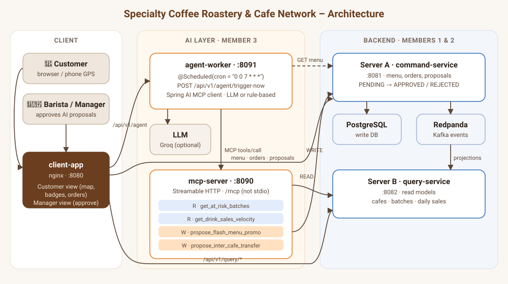

# ☕ Specialty Coffee Roastery & Cafe Network

A distributed system for a network of specialty coffee cafes. It tracks how fresh the coffee, matcha and milk are, lets customers find the closest cafe and order, and uses an **autonomous AI agent** that every morning proposes flash promos or stock transfers between cafes to cut waste and avoid stock-outs. Every AI decision has to be approved by a human.



## Team split

| Member | Responsibility | Module(s) |
|---|---|---|
| Member 1 | **Server A** – command / write side (menu, orders, proposals), PostgreSQL, Kafka events | `command-service/` |
| Member 2 | **Server B** – query / read side (projections: batches, sales, cafes) | `query-service/` *(in progress)* |
| Member 3 | **Remote MCP server**, **autonomous agent**, **client app** | `mcp-server/`, `agent-worker/`, `client-app/` |

## Services

| Container | Port | Tech | What it does |
|---|---|---|---|
| `postgres-write` | 5432 | PostgreSQL 16 | Write database for Server A |
| `redpanda` | 19092 | Kafka-compatible broker | Events from Server A to Server B |
| `command-service` | 8081 | Spring Boot 3.4 | **Server A**: commands, menu, orders, PENDING proposals |
| `query-service` | 8082 | Spring Boot | **Server B**: read models (batches, sales, cafes) |
| `mcp-server` | 8090 | Spring Boot 3.5 + Spring AI 1.1 MCP server (webmvc) | Exposes 4 MCP tools over **Streamable HTTP** (`/mcp`) |
| `agent-worker` | 8091 | Spring Boot 3.5 + Spring AI MCP client + LLM | Runs at 07:00 every day, can be triggered via `POST /api/v1/agent/trigger-now` |
| `client-app` | 8080 | Vanilla JS + Leaflet, nginx | Customer view and Barista/Manager view |

## MCP tools (Member 3)

| Tool | Type | Backend |
|---|---|---|
| `get_at_risk_batches(cafe_id, hours_to_expiry_or_stale)` | read | Server B – coffee older than 21 days since roast, matcha open more than 25 days, milk expiring within 48 h |
| `get_drink_sales_velocity(cafe_id, days)` | read | Server B – cups/day for Espresso, Decaf, Matcha, Tea, Hot Chocolate |
| `propose_flash_menu_promo(cafe_id, menu_item_ids, discount_pct, duration_hours, reason)` | write | Server A – PENDING happy-hour bundle |
| `propose_inter_cafe_transfer(from_cafe_id, to_cafe_id, batch_id, quantity_grams, reason)` | write | Server A – PENDING stock transfer |

## Quick start

```bash
cp .env.example .env          # optional: put your own AI_API_KEY in .env (git-ignored)
docker compose up --build
```

| URL | |
|---|---|
| http://localhost:8080/#customer | Customer view (map, freshness badges, ordering) |
| http://localhost:8080/#manager | Barista / Manager view (approve / reject AI proposals) |
| `curl -X POST http://localhost:8091/api/v1/agent/trigger-now` | Run the AI agent now (live demo) |
| http://localhost:8090/mcp | MCP endpoint (for example with MCP Inspector) |

Without `AI_API_KEY` the agent runs in **rule-based** mode, so the demo still works without an LLM.

### Running a module without Docker

```bash
cd mcp-server && ./mvnw spring-boot:run      # needs JDK 21
cd agent-worker && ./mvnw spring-boot:run
cd client-app && python -m http.server 5173  # UI falls back to offline demo data if the APIs are down
```

## Documentation

| Document | Content |
|---|---|
| [docs/architecture.md](docs/architecture.md) | Architecture, deployment and component diagrams |
| [docs/agent-flow.md](docs/agent-flow.md) | Sequence diagram of the morning agent run and the decision logic |
| [docs/proposal-lifecycle.md](docs/proposal-lifecycle.md) | Proposal state machine and approve / reject flow |
| [docs/client-app.md](docs/client-app.md) | Client UI flows, screen layouts and freshness badge rules |
| [docs/member3-mcp-agent-client.md](docs/member3-mcp-agent-client.md) | Detailed spec and the REST contract expected from Server A and Server B |

The diagrams use [Mermaid](https://mermaid.js.org/), which GitHub renders directly. The SVGs are in [`docs/images/`](docs/images).

## Security

The repository is **public**. Secrets (such as `AI_API_KEY`) are read only from environment variables or a local `.env` file, which is listed in `.gitignore`. Never commit real keys, tokens or passwords.
