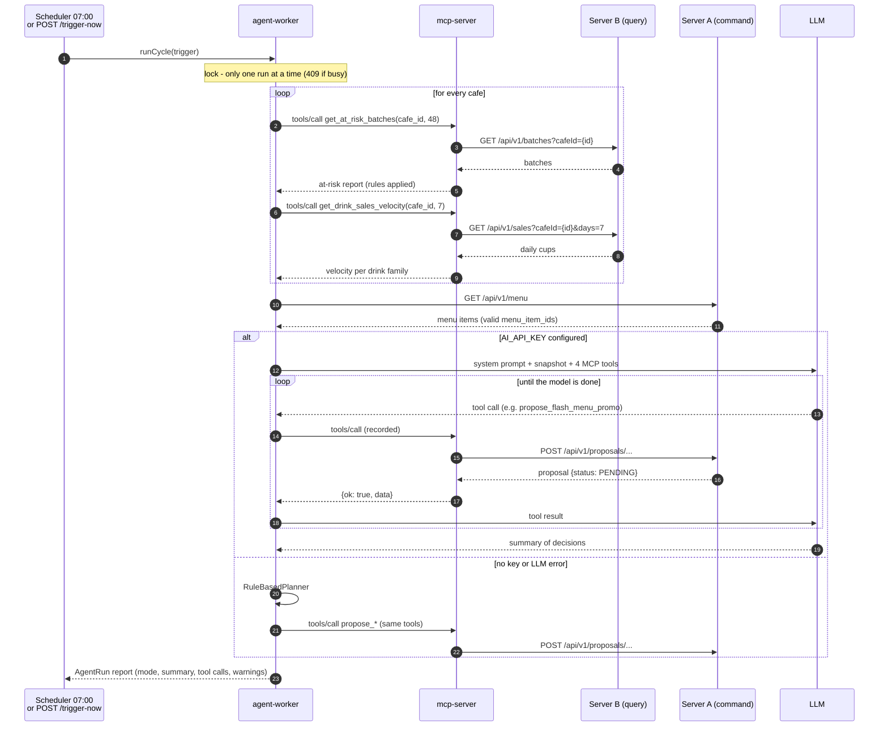
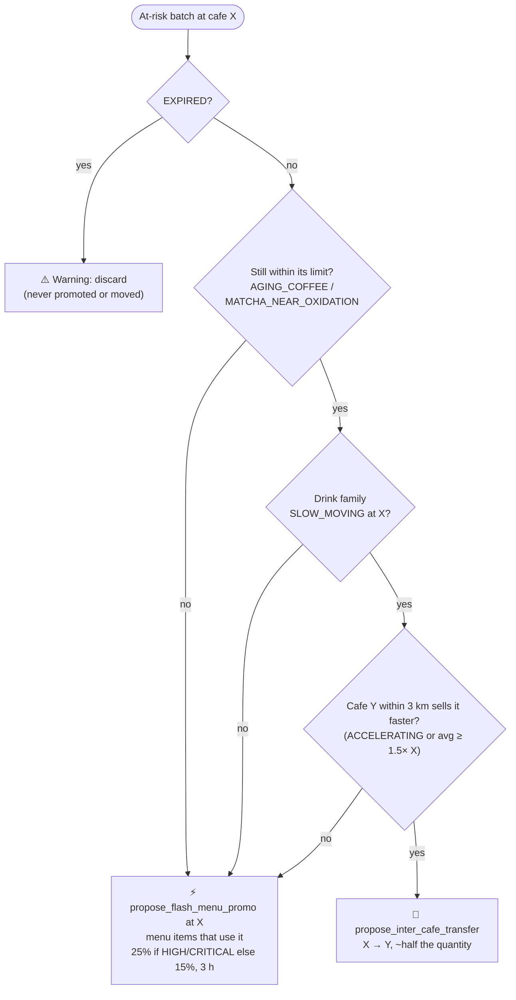
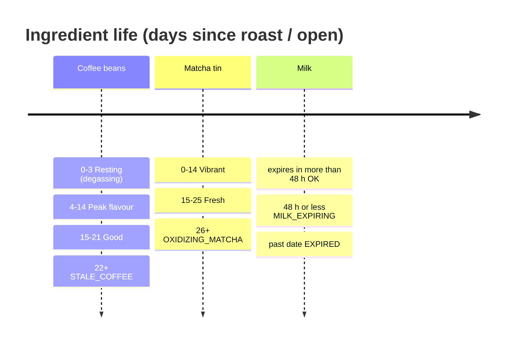

# Autonomous agent – morning run

## 1. Sequence



## 2. Decision logic



| Ingredient category | Drinks used for the promo |
|---|---|
| `OAT_MILK`, `DAIRY_MILK`, `SOY_MILK` | Matcha lattes, Hot Chocolate |
| `MATCHA_TIN` | Matcha drinks |
| `DECAF_BEAN` | Decaf drinks |
| `ESPRESSO_BEAN`, `FILTER_BEAN` | Espresso / filter coffee |
| `LOOSE_TEA` | Tea |
| `COCOA_BATCH` | Hot Chocolate |

## 3. Freshness rules (`get_at_risk_batches`)



Batches that will cross a limit **within the requested window** are reported early (`AGING_COFFEE`, `MATCHA_NEAR_OXIDATION`), so the agent can move them while they are still sellable.

## 4. Run report example (`POST /api/v1/agent/trigger-now`)

```json
{
  "runId": "82e0e2c4",
  "trigger": "MANUAL",
  "mode": "RULE_BASED",
  "status": "SUCCESS",
  "cafesAnalysed": ["CAFE-01", "CAFE-02", "CAFE-03"],
  "summary": "Transfer 500 g B-DEC-07 CAFE-01 -> CAFE-02: PENDING\nFlash promo CAFE-01 25% on Iced Matcha Latte & Hot Chocolate: PENDING",
  "proposalsCreated": 2,
  "toolCalls": [ { "tool": "get_at_risk_batches", "write": false, "ok": true }, "..." ],
  "warnings": ["No LLM API key configured (AI_API_KEY) - used rule-based planner"]
}
```
