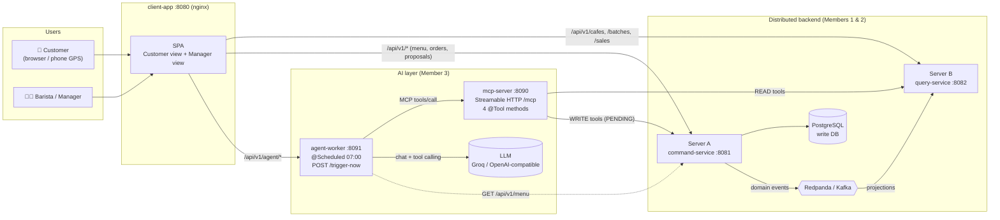
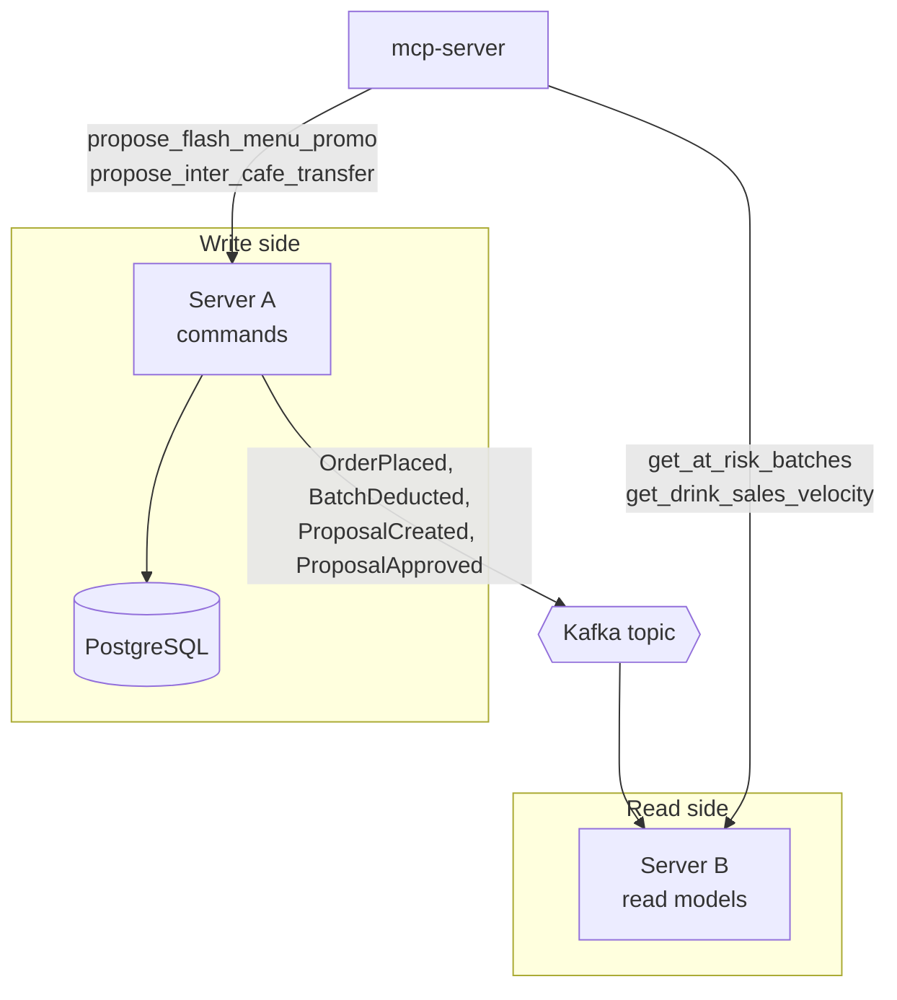
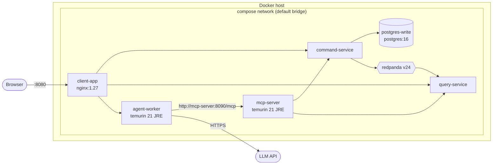
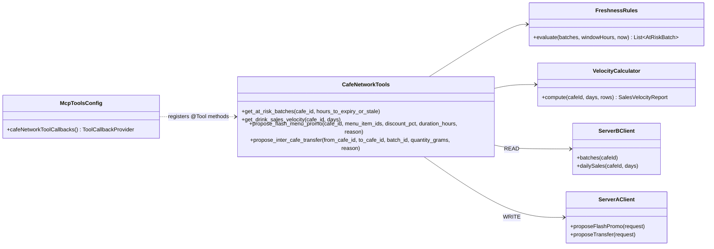
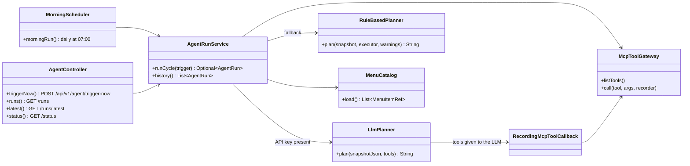

# Architecture

## 1. System overview

## 2. CQRS + AI data flow

The agent never changes data directly: it can only create **PENDING** proposals. A human approves them in the Manager view, and only then does Server A apply the change (discount or stock move) and publish the event.

## 3. Deployment (docker compose)

| Container | Image | Exposed | Depends on |
|---|---|---|---|
| `mcp-server` | built from `mcp-server/Dockerfile` | 8090 | Server A, Server B (resolved at call time) |
| `agent-worker` | built from `agent-worker/Dockerfile` | 8091 | `mcp-server` (healthcheck) |
| `client-app` | built from `client-app/Dockerfile` | 8080 → 80 | proxies to A, B, agent (uses Docker DNS, starts even if one is down) |

## 4. Components – mcp-server

## 5. Components – agent-worker

