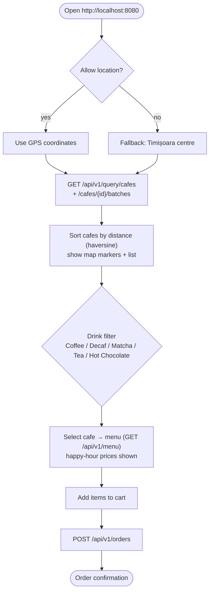
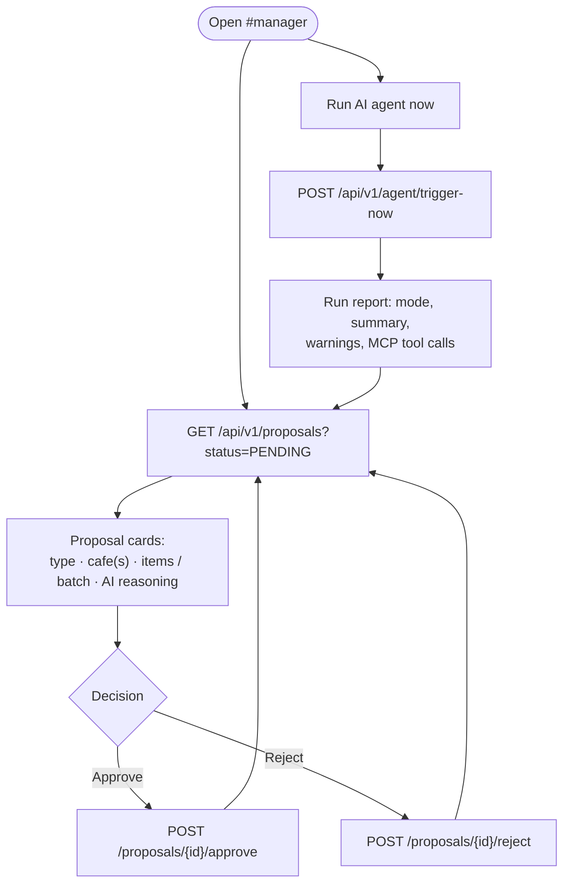

# Client app – UI flows

Single-page app (`client-app/`) with two views, switched by the URL hash: `#customer` and `#manager`.

## 1. Customer flow



## 2. Manager flow



## 3. Screen layouts

**Customer view**

```
┌──────────────────────────────────────────────────────────────────────────┐
│ ☕ Specialty Coffee Network                    [Customer] [Barista/Manager] │
├──────────────────────────────────────────────────────────────────────────┤
│ (All)(Coffee)(Decaf)(Matcha)(Tea)(Hot Chocolate)   Showing cafes near you │
├────────────────────────────┬──────────────────────┬──────────────────────┤
│                            │ Closest cafes        │ Menu – Roastery V.   │
│        🗺  MAP             │ ┌──────────────────┐ │ Iced Matcha  -25%    │
│   • you    📍 cafes        │ │Roastery V.  0.2km│ │   19.00 → 14.25 [Add]│
│                            │ │[Espresso: 9 days │ │ Flat White 15.00[Add]│
│                            │ │ – Peak Flavor]   │ │──────────────────────│
│                            │ └──────────────────┘ │ Your order   28.50   │
│                            │ ┌ Campus Cafe 1.3km┐ │ [   Place order   ]  │
└────────────────────────────┴──────────────────────┴──────────────────────┘
```

**Barista / Manager view**

```
┌──────────────────────────────────────────────────────────────────────────┐
│ Cafe [All cafes ▾]  (Pending)(All)               [Refresh] [Run AI agent] │
├──────────────────────────────────────────────────────────────────────────┤
│ Agent run 82e0e2c4 [Rule-based] SUCCESS · 2 proposals · 3 cafes          │
├────────────────────────────────────┬─────────────────────────────────────┤
│ ⚡ Flash menu promo        PENDING │ 🚚 Inter-cafe transfer      PENDING │
│ Cafe     Roastery Victoriei        │ From  Roastery Victoriei            │
│ Items    Iced Matcha, Hot Choc.    │ To    Campus Cafe                   │
│ Discount 25% for 3 h               │ Batch B-DEC-07 – 500 g              │
│ ┃ AI AGENT REASONING               │ ┃ AI AGENT REASONING                │
│ ┃ 25% off … to clear 1.2L oat milk │ ┃ Move 500 g decaf … 1.3 km away    │
│              [Reject] [Approve]    │              [Reject] [Approve]     │
└────────────────────────────────────┴─────────────────────────────────────┘
```

## 4. Freshness badges

| Ingredient | Days since roast / open | Badge |
|---|---|---|
| Espresso / Filter / Decaf beans | 0–3 | 🔵 Roasted N days ago – Resting |
| | 4–14 | 🟢 Roasted N days ago – **Peak Flavor** |
| | 15–21 | 🟡 Roasted N days ago – Good |
| | 22+ | 🔴 Roasted N days ago – Past Peak |
| Matcha tin | 0–14 | 🟢 Opened N days ago – Vibrant |
| | 15–25 | 🟡 Opened N days ago – Fresh |
| | 26+ | 🔴 Opened N days ago – Oxidizing |
| Milk | expires within 48 h | 🟡 Milk: use within Nh |

Each cafe shows the **freshest** badge per drink family.

## 5. Offline demo mode

If the APIs cannot be reached, the UI switches to built-in demo data (`client-app/demo-data.js`) and shows a yellow banner. Orders and approve / reject actions are then simulated locally, so the UI can be shown without the backend.
