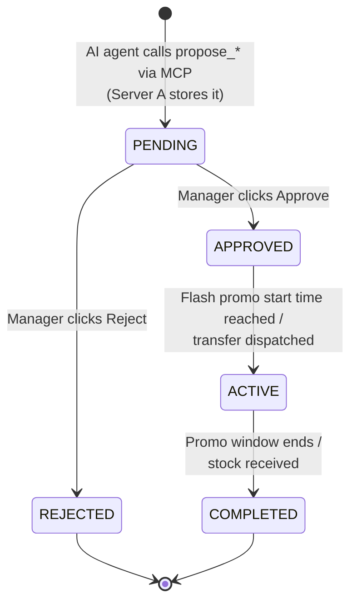
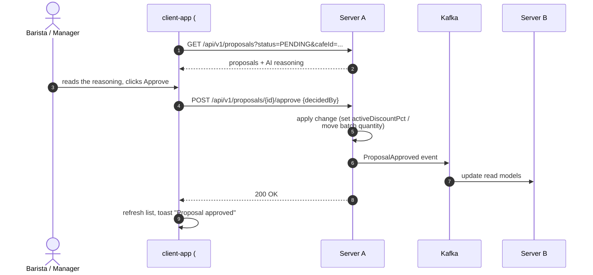
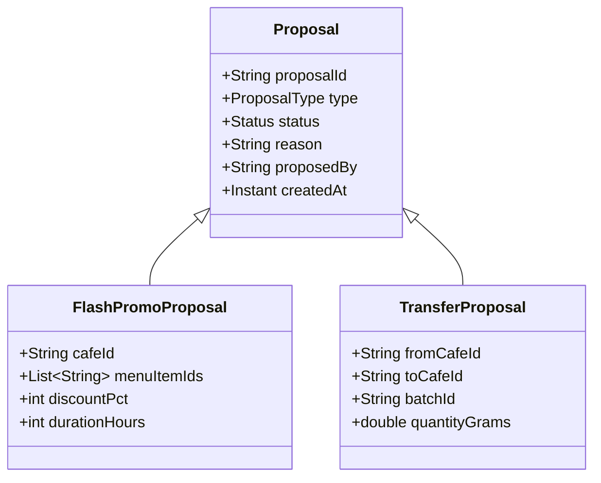

# Proposal lifecycle (human in the loop)

## 1. State machine

> `PENDING`, `APPROVED` and `REJECTED` are used by the client and the agent. `ACTIVE` and `COMPLETED` are optional states that Server A (Member 1) can add.

## 2. Approve / reject flow

## 3. Proposal payloads

Validation is done twice: in the MCP tool, which returns `{ok:false, message}` so the LLM can correct itself, and again in Server A.
